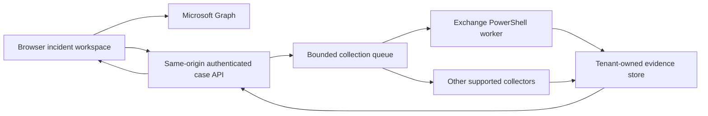

# M365 Triage — deep review and browser execution options

Reviewed 14 September 2026. Repository commit **8fb921c**, main build **14**, beta build **2**. Scope: main SPA, tenant analyzer beta, import/export, detections, containment, Exchange backend, app provisioning, Docker packaging and current interface. This is a code and offline behavior review, not a penetration test or a tenant certification. No production code, app registrations or tenant settings were changed.

## Assessment

**Keep developing this tool, but address evidence correctness and the Exchange execution path before extending live containment.** Its strongest feature is the short route from a suspected account to findings, evidence and a response runbook. Plain JavaScript makes it easy to deploy and inspect, the demo is useful, and the optional backend keeps the static analysis path lightweight.

The main weaknesses are substantive rather than cosmetic. Missing data can look like a completed check; imports can attribute activity to the wrong person; evidence exports are inconsistent; and the default mailbox workflow conflicts with its own backend limits. The backend has useful controls, but its documentation overstates what those controls guarantee.

The practical product direction is **one incident workspace with a browser interface, direct Graph collection and an optional tenant-owned Exchange worker**. Preserve the ability to analyze imported evidence without a backend. Put reliable source coverage and case identity at the center of the next version.

## What is already worth keeping

- Pure detection functions, separate from much of the rendering, provide a useful testing seam.
- MSAL public-client authentication avoids putting an application credential in the SPA.
- Backend token signature, audience, tenant and client checks; fixed actions; named PowerShell arguments; process timeout; unprivileged container; no directly published backend port.
- Per-action confirmation and explicit containment arming are good user safeguards, although they are not independent authorization boundaries.
- The latest main-branch UAL correction uses `userPrincipalNameFilters` and rejects events with a different known actor in the main detector. Extend this discipline across all sources and consumers.
- Main JSON export includes collected evidence, and report text generally escapes HTML. Keep both practices.

## Findings, prioritized

P1 means fix before relying on the affected production workflow. P2 means a meaningful reliability, coverage or usability improvement. “Reproduced” refers to offline fixtures or the local demo; it does not mean a real tenant was exercised.

### 1. P1 — Docker builds can retain backend credentials and expose audit files

**Evidence:** [.dockerignore](/Users/mihaimonte/REPO/triage/.dockerignore:1), [Dockerfile](/Users/mihaimonte/REPO/triage/Dockerfile:33), [nginx](/Users/mihaimonte/REPO/triage/docker/nginx.conf:5).

The build context excludes `evidence`, but not `certs/`, `backend.env`, `.env` or `audit/`. `COPY .` places the whole context in the web image. Deleting certificates and `*.env` in a later layer does not remove them from the earlier image layer. `audit/` is not removed from the final web root. The shell pattern `*.env` also does not match the hidden `.env` file; the script-generated `.env` currently contains a public app ID, but this is unsafe for any future secret added there.

**Trigger:** configure the backend locally, then build the web image from that checkout. If the image is shared, its earlier layers can contain the private key and PFX password. An included audit directory can be served by nginx. This is a packaging defect; I did not find or extract actual credentials, and no Docker build was run.

**Improve:** copy only approved web assets; exclude all credentials, logs, evidence and review artifacts from the build context; deny dotfile paths; inspect the resulting image archive with synthetic secret markers. Docker has dedicated mechanisms for build secrets when they are actually needed; this web build should need none. [Docker build secrets](https://docs.docker.com/build/building/secrets/).

### 2. P1 — Backend authorization can grant mailbox powers the caller does not hold

**Evidence:** [default roles](/Users/mihaimonte/REPO/triage/backend/server.js:47), [authorization](/Users/mihaimonte/REPO/triage/backend/server.js:213), [app-only execution](/Users/mihaimonte/REPO/triage/backend/exo.ps1:48).

Security Administrator and Privileged Role Administrator are accepted alongside Global and Exchange Administrator. A qualifying role passes the gate for every backend operation and every unprotected mailbox the application can reach. The subsequent Exchange action uses the application's rights, not the analyst's Exchange session. There is no check of the caller's allowed mailbox scope or individual cmdlet permission.

Microsoft specifically distinguishes Security Administrator from roles with full recipient-management powers. Therefore “the backend never grants anyone a capability they did not already have” is not a valid guarantee. [Exchange app-only roles and permissions](https://learn.microsoft.com/en-us/powershell/exchange/app-only-auth-powershell-v2?view=exchange-ps).

**Improve:** define an explicit authorized responder role for the application, separate reader/operator permissions, enforce tenant + case + canonical mailbox ID + operation on the server, and scope the worker's Exchange rights independently. Treat this as delegated authority through a service, not proof of the caller's equivalent Exchange permissions. Test allowed and denied callers and out-of-scope mailboxes.

### 3. P1 — Uncollected UAL data is reported as a completed zero-result check

**Evidence:** [empty UAL fallback](/Users/mihaimonte/REPO/triage/js/blast.js:55), [MailItemsAccessed check](/Users/mihaimonte/REPO/triage/js/blast.js:226), [run-all and completion](/Users/mihaimonte/REPO/triage/js/contain.js:481).

The UI warns when UAL is not loaded, but its check functions still consume an empty array. “Run all” runs those functions, ticks them complete, and can report zero MailItemsAccessed, SharePoint or Teams events. **Reproduced:** MailItemsAccessed returned zero with no UAL loaded and no failed/unavailable status.

The same code can reuse a shorter UAL window for a longer blast-radius request: availability tests data presence, not coverage. Exporting a check can tick a broad evidence checklist item even if it contains only that check's subset. A running result can also be exported as “answered” because export tests `failed`, not `running`.

**Improve:** require a successful source collection with an adequate time window before a dependent check runs. Use `not collected`, `running`, `partial`, `complete`, `unavailable`, `failed` and `cancelled` states. Only a completed source with zero rows supports “no events observed.” A downloaded subset is not proof that the full evidence category has been preserved.

### 4. P1 — Pagination caps silently truncate investigations

**Evidence:** [main pagination](/Users/mihaimonte/REPO/triage/js/graph.js:102), [beta pagination](/Users/mihaimonte/REPO/triage/BETA/js/graph.js:110), [main collection](/Users/mihaimonte/REPO/triage/js/app.js:428), [beta collection](/Users/mihaimonte/REPO/triage/BETA/js/collect.js:32).

Both helpers return an ordinary array when a page limit is reached, even if `@odata.nextLink` remains. Main sign-ins request up to 20 × 500 rows; beta requests up to 40 × 1,000. UAL and directory collections have their own caps. These are requested upper bounds, not guarantees about actual page size. The UI still marks the step successful. Neither helper implements throttling backoff or resumable collection.

**Reproduced:** a one-page collection with a continuation link returned one row and no partial flag.

**Improve:** return records plus completion status, continuation, request window, observed range, page count and errors. Follow pagination to completion, or explicitly checkpoint it. Respect `Retry-After`, bound retries and preserve already collected pages. Use time partitions for large tenant jobs.

A 90-day selector does not create 90 days of Entra history. Normal Entra audit/sign-in retention is 7 days for Free and 30 days for P1/P2; exported archives and other licensed retention paths need separate collection support. UAL retention is separate. [Microsoft Entra retention](https://learn.microsoft.com/en-us/entra/identity/monitoring-health/reference-reports-data-retention).

### 5. P1 — Exit/sign-out does not clear investigation state or cancel work

**Evidence:** [main endSession](/Users/mihaimonte/REPO/triage/js/app.js:282), [scan completion](/Users/mihaimonte/REPO/triage/js/app.js:489), [containment identity comparison](/Users/mihaimonte/REPO/triage/js/contain.js:1465), [beta endSession](/Users/mihaimonte/REPO/triage/BETA/js/app.js:101).

The exit handler resets navigation but retains selected user, evidence, rendered findings and containment module state. Case matching uses UPN alone. Running asynchronous work has no session generation guard or cancellation token; a completed old scan can write back into the current UI. Starting another scan also does not actually discard the older scan's eventual result.

**Browser reproduction:** after exiting the demo, the login screen was visible but `TriageContain.target` still held Jan and 15 finding rows remained in the document. This confirms residual state, not a demonstrated cross-tenant network read.

**Improve:** one session teardown that aborts requests, invalidates pending callbacks, clears every store/DOM view and closes confirmations. Key case state by tenant ID + object ID + case ID. Capture the target and session in each approved action and revalidate them immediately before execution. Add tests for sign-out during scans, switching accounts, switching tenants, and demo-to-live transitions.

### 6. P1 — One mailbox load creates more concurrent work than the backend permits

**Evidence:** [three parallel calls](/Users/mihaimonte/REPO/triage/js/contain.js:1085), [default concurrency](/Users/mihaimonte/REPO/triage/backend/server.js:62), [busy rejection](/Users/mihaimonte/REPO/triage/backend/server.js:250).

The browser requests rules, forwarding and delegates simultaneously. The default backend permits two PowerShell processes and rejects the third with 503. `Promise.all` then fails the entire mailbox display. **Reproduced with mocked processes:** the third simultaneous operation returned “backend busy, retry shortly.”

**Improve:** one mailbox snapshot operation using one Exchange connection, or a bounded server queue. Render each source's status independently. Merely increasing the limit to three still fails with concurrent analysts and wastes repeated Exchange connection startup.

### 7. P1 — PowerShell JSON changes shape when there is one rule or delegate

**Evidence:** [Out-Json](/Users/mihaimonte/REPO/triage/backend/exo.ps1:33), [rules output](/Users/mihaimonte/REPO/triage/backend/exo.ps1:57), [browser array use](/Users/mihaimonte/REPO/triage/js/contain.js:1137).

`$o | ConvertTo-Json` enumerates arrays. Zero records produce no JSON text; one record produces an object; two produce an array. The browser calls array operations such as `.map()` and `.filter()` on the response.

**Reproduced in local PowerShell:** 0 → empty output; 1 → object; 2 → array. A mailbox with exactly one suspicious rule is therefore a particularly bad edge case.

**Improve:** serialize a stable response envelope with explicit arrays using `ConvertTo-Json -InputObject`, validate the API response schema, and reserve stdout for that response. Cover zero, one and many records plus cmdlet warnings and errors.

### 8. P1 — Main imports can attribute multiple users' evidence to one account

**Evidence:** [CSV normalization](/Users/mihaimonte/REPO/triage/js/import.js:87), [merge and subject selection](/Users/mihaimonte/REPO/triage/js/import.js:177), [inferUpn](/Users/mihaimonte/REPO/triage/js/import.js:244), [detector attribution](/Users/mihaimonte/REPO/triage/js/detections.js:40).

The importer selects the first UPN and concatenates all sign-ins and grants. The sign-in detector attributes every generated finding to `ev.upn` without enforcing per-record ownership. The recent UAL actor guard does not cover sign-ins. CSV normalization also drops the UPN, and unrecognized status text such as `Failure` becomes error code zero.

**Reproduced:** Alice's successful sign-in and Bob's failures produced a Critical finding assigned to Alice. A CSV row with `Status=Failure` became successful and lost its subject.

**Improve:** validate source schema, preserve tenant/user IDs, separate users before analysis, require a subject choice for multi-user inputs, deduplicate by source event ID, and reject ambiguous status values. Imported evidence should never silently replace a native evidence bundle's subject or merge incompatible tenants.

### 9. P1 — Beta “Evidence JSON” does not preserve the evidence

**Evidence:** [beta JSON export](/Users/mihaimonte/REPO/triage/BETA/js/report.js:138), [beta import routing](/Users/mihaimonte/REPO/triage/BETA/js/import.js:47).

The export contains findings, account rollups and statistics, but omits the collected raw events, source errors and acquisition context. It cannot reproduce the investigation. **Reproduced:** its own exported object shape is classified as unknown when imported.

**Improve:** separate “Findings report” from “Evidence bundle.” Use a versioned bundle with raw sources, source manifests, exact query intervals, tenant/object identities, acquisition times, collector and rule versions, errors and hashes. Require export → import → equivalent analysis tests. A hash helps detect changes; it is not proof of authenticity by itself.

### 10. P2 — Coverage claims exceed the actual collection and analysis

**Evidence:** [beta sign-ins](/Users/mihaimonte/REPO/triage/BETA/js/collect.js:9), [main directory collection](/Users/mihaimonte/REPO/triage/js/app.js:434), [target-change caveat](/Users/mihaimonte/REPO/triage/js/blast.js:350), [beta MFA initialization](/Users/mihaimonte/REPO/triage/BETA/js/collect.js:20).

- Beta labels its step “interactive + non-interactive” but does not request the event-type filter. Microsoft returns interactive sign-ins by default. Main's separate blast check does request non-interactive events, but its “/ SP” label does not mean it collects service-principal activity. [Sign-in API](https://learn.microsoft.com/en-us/graph/api/signin-list?view=graph-rest-beta).
- Main collects directory audits but the main detection engine never reads `ev.directoryAudits`. **Reproduced:** a role-change event in that array yielded no finding. Some events may separately appear in UAL, but that is not a substitute for analyzing this source.
- Directory audit collection is actor-only. The claim that Graph cannot filter changes made **to** the user is incorrect: the resource documents filtering `targetResources` by ID. Collect actor and target queries separately, deduplicate, and preserve that distinction. [Directory audit resource](https://learn.microsoft.com/en-us/graph/api/resources/directoryaudit?view=graph-rest-1.0).
- Beta initializes `mfa: []` but never collects it live. It loses `principalId` when normalizing OAuth grants, leaves `principalUpn` empty, and omits application permission assignments. Some per-account risk therefore never reaches the account rollup.
- Beta slices certain detections to 10/20/40 events before creating findings. A display limit should not become an undisclosed analysis limit. Its “coverage” pills derive from emitted findings, so a successful source with no findings looks absent.

**Improve:** maintain a capability catalog distinguishing collected, analyzed, partial, import-only and unsupported. Drive documentation and UI from it. Add explicit non-interactive and linked service-principal collection, live MFA reporting, OAuth principal resolution and an application-permission path.

### 11. P2 — Several rules promote weak or contrary evidence to high confidence

**Evidence:** [brute-force ordering](/Users/mihaimonte/REPO/triage/js/detections.js:83), [risk classification](/Users/mihaimonte/REPO/triage/js/detections.js:137), [forwarding detection](/Users/mihaimonte/REPO/triage/js/detections.js:292), [beta IP-pair rule](/Users/mihaimonte/REPO/triage/BETA/js/analyzers.js:191).

**Reproduced:** a success one day before ten failures is described as a password attack followed by success. A `hidden` risk value becomes a risky-sign-in finding. Clearing forwarding (`ForwardingSmtpAddress=null`) becomes a Critical “forwarding configured” finding because the detector matches the parameter name rather than its value.

Other calibration issues: any country change within two hours is called impossible travel; two successful IPs within 30 seconds are Critical in beta; high-risk permissions alone can be Critical in main. These patterns can reflect VPNs, shared egress, multiple devices or legitimate app use. Missing device identity does not establish AiTM. Microsoft defines `hidden` as unavailable risk detail, not positive risk. [Sign-in risk fields](https://learn.microsoft.com/en-us/graph/api/resources/signin?view=graph-rest-beta).

**Improve:** separate severity, confidence and analyst disposition. Check temporal ordering and a bounded attack window; parse exact permission/parameter values; use configured baselines and exceptions; correlate session, device, IP, actor and resource; test benign counterexamples alongside malicious fixtures. Preserve administrative and non-human events without automatically treating them as benign. Record stable rule IDs and evidence IDs for each finding.

### 12. P2 — Beta's import-only Exchange coverage is not implemented as advertised

**Evidence:** [beta README](/Users/mihaimonte/REPO/triage/BETA/README.md:29), [filename classifier](/Users/mihaimonte/REPO/triage/BETA/js/import.js:47), [MFA parser](/Users/mihaimonte/REPO/triage/BETA/js/import.js:116).

There are no dedicated inventory routes/analyzers for mailbox permissions, transport rules, mailbox audit status or message trace. The generic `/permission/` filename match routes `MailboxPermissions.csv` into OAuth. `UnifiedAuditLog` filenames can match the directory-audit branch before the UAL branch. Native MFA `methodsRegistered` arrays cause `.split is not a function`. Malformed JSONL lines are silently skipped.

**Reproduced:** mailbox-permission misclassification and native MFA-array failure. These are not fixed by adding an Exchange collector; the output must have a supported analysis contract.

**Improve:** explicit artifact schemas and versioned adapters, narrow classification with shape validation, per-file rejected-row reporting, deterministic deduplication and import fixtures from each supported Extractor-Suite output. Correct the documentation until these analyzers exist.

### 13. P2 — The seven-operation Exchange backend is not full BEC acquisition

**Evidence:** [rules enumeration](/Users/mihaimonte/REPO/triage/backend/exo.ps1:55), [delegates enumeration](/Users/mihaimonte/REPO/triage/backend/exo.ps1:113), [route allowlist](/Users/mihaimonte/REPO/triage/backend/server.js:297).

`Get-InboxRule` omits `-IncludeHidden`. Delegate collection uses `Get-MailboxPermission` and deletion is fixed to `FullAccess`; SendAs, SendOnBehalf and mailbox-folder permissions are distinct surfaces. Transport rules, connectors, message trace and mailbox audit configuration are absent. A “delegates clean” conclusion needs to distinguish all these permission types. [Get-InboxRule hidden rules](https://learn.microsoft.com/en-us/powershell/module/exchangepowershell/get-inboxrule?view=exchange-ps).

**Improve:** add a read-only mailbox snapshot first: hidden rules, forwarding, FullAccess, SendAs, SendOnBehalf, relevant folder permissions and audit configuration. Add tenant transport/connectors and time-bounded trace separately. Make scope explicit; current configuration and historical activity answer different questions.

### 14. P1 for deployment — Provisioning and runtime defaults need an end-to-end validation pass

**Evidence:** [generated RBAC commands](/Users/mihaimonte/REPO/triage/create-backend-appreg.ps1:187), [file permissions](/Users/mihaimonte/REPO/triage/create-backend-appreg.ps1:98), [container user](/Users/mihaimonte/REPO/triage/backend/Dockerfile:29), [audit failure handling](/Users/mihaimonte/REPO/triage/backend/server.js:75).

The printed `New-ManagementRoleAssignment -App ... -Role 'Mail Recipients'` instructions conflate application data RBAC with Exchange PowerShell management role groups. Follow Microsoft's documented custom-role-group/service-principal procedure for cmdlet access; application data RBAC is a separate permission model. Do not assume the printed commands establish the intended restrictions. [PowerShell custom role groups](https://learn.microsoft.com/en-us/powershell/exchange/app-only-auth-powershell-v2?view=exchange-ps), [application data RBAC](https://learn.microsoft.com/en-us/exchange/permissions-exo/application-rbac).

On native Linux, keys created as mode 0600 by the host user are not automatically readable by container UID 10001. A host-mounted audit directory also needs compatible ownership. Docker Desktop mount behavior should be tested separately. Health currently reports OK without testing certificate readability, expiry, audit durability, EXO connection or effective commands.

The backend's Debian base and unpinned latest EXO module are not a tested compatibility pair. Microsoft lists specific Ubuntu/PowerShell/module combinations and currently says `Connect-IPPSSession` is unavailable on Linux. Thus the companion cannot be assumed to run every compliance/extraction command merely because module installation succeeds. [EXO module platform support](https://learn.microsoft.com/en-us/powershell/exchange/exchange-online-powershell-v2?view=exchange-ps).

**Improve:** idempotent provisioning, protected credential rotation, mounted-secret ownership checks, writable audit-volume checks, readiness distinct from liveness, pinned compatible versions and a real sandbox-tenant acceptance test. The CI workflow currently builds on an Ubuntu runner without an explicit ARM64 matrix; verify published architectures before promising native M4 support.

### 15. P2 — Security documentation and action verification promise more than the implementation

**Evidence:** [security document](/Users/mihaimonte/REPO/triage/SECURITY.md:1), [JWT issuer check](/Users/mihaimonte/REPO/triage/backend/server.js:148), [role cache](/Users/mihaimonte/REPO/triage/backend/server.js:213), [audit](/Users/mihaimonte/REPO/triage/backend/server.js:75), [action success](/Users/mihaimonte/REPO/triage/js/contain.js:960).

- The backend is credentialed processing outside the browser; downloaded reports are files on disk. MSAL also uses session storage. Describe each execution mode accurately.
- `connect-src` limits fetch-style connections; it is not a complete exfiltration guarantee. Malicious same-origin code can also act through allowed APIs. GitHub Pages does not inherit the nginx headers.
- Role membership is cached for five minutes, not fetched every request. That is not a guaranteed five-minute bound on session revocation propagation. Preauthorization is a consent convenience, not by itself an exclusive client allowlist; the backend's client claim check is the relevant enforcement.
- Audit writes happen after operations and errors are swallowed. Appending to a writable file is not tamper-resistant storage. Failure records omit target details. A missing durable audit sink should block a mutation or trigger an explicit emergency policy, not silent success.
- JWT issuer validation is prefix-based, and key refresh does not retry an unknown key ID. Use supported token-validation middleware with exact issuer/audience/tenant and key rollover handling. Add HTTP timeouts and response-size limits.
- A successful HTTP request becomes “done” without consistent state readback. Session revocation can take minutes and does not revoke external-user home-tenant sessions. Show request accepted, propagation pending and verified as different outcomes. [Revoke sign-in sessions](https://learn.microsoft.com/en-us/graph/api/user-revokesigninsessions?view=graph-rest-1.0).

**Improve:** concise per-mode data-flow documentation; explicit effective authority; durable before/after audit with operation IDs; canonical protected-mailbox identity rather than only UPN-string checks; idempotency and readback for changes; reauthentication/authorization checks where required. Keep emergency response available, but label any evidence-preservation override and record its reason.

### 16. P2 — Maintainability and UI need a shared case model

**Evidence:** [main orchestration](/Users/mihaimonte/REPO/triage/js/app.js:1), [containment](/Users/mihaimonte/REPO/triage/js/contain.js:15), [findings interaction](/Users/mihaimonte/REPO/triage/js/report.js:115), [test path](/Users/mihaimonte/REPO/triage/BETA/beta.engine.test.mjs:3), [DOM test](/Users/mihaimonte/REPO/triage/BETA/beta.dom.test.mjs:2).

Main and beta duplicate auth, collection, imports, reports and rules with differing behavior. The unused beta per-user UAL helper still has the obsolete `userPrincipalNames` property. Containment spans nearly 1,500 lines, with rendering, execution, evidence and templates sharing mutable globals.

The existing tests hardcode a previous machine's path; the DOM suite requires `jsdom` without a dependency manifest. The checked-in Docker workflow does not gate publishing on these tests. Current findings rows are click-only and lack native keyboard controls for opening details. Modals need focus handling. **Measured:** beta document width was 549px at a 390px viewport.

**Improve:** shared ES modules for authentication, request handling, normalized evidence and rule evaluation; a small explicit case/session store; separate collection, analysis and action services. Keep deployment simple—this does not require a framework rewrite. Add a lockfile and portable test paths, behavior tests for the defects above, request-schema fixtures, CI checks and browser keyboard/responsive coverage. Use native buttons or `details/summary` for expandable findings. CSV exports should neutralize spreadsheet formula prefixes as well as escape quotes.

## Can it run completely from the browser?

**As a user experience: yes, with an execution service. As a static browser application running every Exchange cmdlet itself: no supported complete route was established.** Docker runs on a host; a normal web page cannot start a local process or connect directly to the Docker Unix socket. A PWA or WebAssembly runtime does not automatically supply supported Exchange PowerShell modules, host access, credentials or API permissions.

| Work | Direct browser path | What to add or retain |
|---|---|---|
| Entra users, sign-ins, audits, risk, authentication methods, delegated grants | Graph with appropriate delegated scopes, roles and licenses | Correct filters, pagination, coverage and identity binding |
| UAL collection | Graph asynchronous audit queries | Job IDs, resumable polling, exact windows and complete pagination |
| Parse imports, run rules, show reports | Browser | Web Workers/streaming for large files; versioned evidence adapters |
| Revoke sessions, disable account, supported identity changes | Delegated Graph, subject to role/target restrictions | Per-action validation and verification |
| Another user's inbox rules | Graph application permission through a service, or EXO worker | An admin's delegated Graph token is not arbitrary mailbox access. The rules endpoint supports application permission; do not put its credential in the SPA. [Graph rules API](https://learn.microsoft.com/en-us/graph/api/mailfolder-list-messagerules?view=graph-rest-1.0) |
| Full mailbox/tenant configuration, hidden rules, FullAccess/SendAs, transport/connectors, trace | EXO PowerShell worker is the broad path | Explicit read-only collectors and tested cmdlet support |
| Selected folder permissions and SendOnBehalf | New Exchange Admin API preview | Potential REST replacement for specific commands, not the full tool |
| Power Platform and other workloads | Separate APIs/connectors and permissions | Do not interpret “not available through our Graph scopes” as “no API exists” |
| Historical data already outside retention | Existing tenant archives, SIEM/storage or saved extraction | Docker cannot recover data Microsoft no longer retains |

### The Exchange Admin API changes part of the answer

Microsoft now documents a **preview** Exchange Online Admin API with a limited set of endpoints: organization configuration, accepted domains, group membership, mailbox and mailbox-folder permissions. It explicitly does not replace Exchange Online PowerShell and is not available in every organization. [API overview](https://learn.microsoft.com/en-us/exchange/reference/admin-api-overview).

It documents delegated `Exchange.ManageV2` and application `Exchange.ManageAsAppV2` access, with Exchange RBAC. These are distinct from the existing PowerShell `Exchange.ManageAsApp` permission. Delegated authentication makes a browser experiment plausible, but the documentation reviewed does not establish end-to-end cross-origin browser support for this site. Treat CORS/preflight, tenant rollout, token acquisition, pagination and CSP as acceptance tests, not assumptions. [Authentication](https://learn.microsoft.com/en-us/exchange/reference/admin-api-authentication), [request model](https://learn.microsoft.com/en-us/exchange/reference/admin-api-get-started).

The documented `Set-Mailbox` surface is restricted to `GrantSendOnBehalfTo`; it is not a general forwarding-clearing endpoint. Preview `Get-Mailbox` currently returns broader output that Microsoft says will be narrowed. Do not build a promised forwarding collector around temporary extra properties. [Mailbox endpoint contract](https://learn.microsoft.com/en-us/exchange/reference/admin-api-endpoints-mailbox).

**Recommendation:** investigate this API behind a capability flag. Use it for supported operations if the tenant and browser tests pass; retain a worker fallback for the full command set. Do not reverse engineer the admin portal or rely on undocumented internal PowerShell REST endpoints as a public browser API.

### Best fit for this repository: browser + tenant-owned worker



The current `/api` reverse proxy is a useful starting point. Extend it into a job service instead of exposing arbitrary commands. The browser submits a named acquisition plan for a fixed tenant, object and time window. The server authorizes the request, queues work, publishes progress and returns a bundle that the shared analysis engine understands.

Suggested first API contract: `POST /api/collections` accepts a case ID, object ID, approved collector IDs and UTC interval; `GET /api/collections/{id}` returns progress and source states; separate cancellation and artifact endpoints check the same caller/case permissions. These are proposed endpoints, not existing features.

Use one bounded Exchange connection per collection job, with per-source timeouts, continuation/checkpoints, cancellation and throttling recovery. Store raw evidence outside the web root. Include the exact commands/parameters and versions in the manifest. Separate read-only collection credentials from optional mutation credentials; do not require mailbox write authority simply to investigate.

For local use, start the stack once and open its local site. Keeping the SPA and `/api` on one origin avoids a public website reaching into localhost. If you retain the hosted site plus a local helper, add explicit origin validation, pairing, tenant checks, TLS/CORS policy and browser local-network compatibility testing. Chromium now has a Local Network Access permission model; old assumptions about public-site-to-localhost requests are insufficient. [Chrome Local Network Access](https://developer.chrome.com/blog/local-network-access).

For a fully hosted analyst experience, run the worker in tenant-owned infrastructure. Azure Automation or an Azure VM is a documented managed-identity route for EXO PowerShell, which can eliminate certificate files. Do not assume that every container hosting product supports the same authentication path without verification. [EXO managed identity support](https://learn.microsoft.com/en-us/powershell/exchange/connect-exo-powershell-managed-identity?view=exchange-ps).

**Do not expose the Docker Engine API to the page or give a generic web command runner the Docker socket.** If a service must start workers, give it fixed image digests, fixed mounts, resource limits and an allowlisted job schema. Docker daemon control can grant access to the host. [Docker Engine security](https://docs.docker.com/engine/security/).

### What “get everything” should mean

Use a manifest of requested and obtainable sources, not a single “full extraction complete” badge. An initial acquisition pack should cover:

1. Interactive and non-interactive sign-ins; related application sign-ins where attribution is defensible.
2. Directory changes by the subject and changes to the subject; current identity, MFA, risk and grant state.
3. UAL for the requested interval, preserving record IDs, actor, target, workload and full raw payload.
4. Current mailbox rules including hidden rules, forwarding and each distinct delegation type.
5. Mailbox auditing/bypass status and relevant tenant transport rules/connectors.
6. Message trace with explicit time partitions and completeness checks.

Current message trace supports the last 90 days, at most 10 days per query, and a maximum result size of 5,000; continuation uses its documented recipient/time parameters rather than ordinary page numbering. A single unbounded command is not a complete acquisition. [Get-MessageTraceV2](https://learn.microsoft.com/en-us/powershell/module/exchangepowershell/get-messagetracev2?view=exchange-ps).

Content acquisition, attachments, eDiscovery, Power Platform and Azure subscriptions should be separate opt-in packs with separate permissions and evidence handling. There is no honest single credential/container promise that every workload and every retention period will be available. The existing PowerShell companion is a useful manual fallback, but it currently has no browser job bridge or automatic evidence handoff.

## Layout proposals

The accompanying interactive design preview contains three screens and two navigation alternatives. All displayed records and job states are illustrative, not review measurements or real tenant findings.

**Investigation workspace:** persistent tenant/case/subject context, compact priority summary, prominent coverage warning, finding list next to evidence detail, and a timeline switch. This brings evidence and confidence alongside the finding instead of making the analyst expand a long table below several summary blocks.

**Collection screen:** source-by-source route, counts, exact coverage and completion state; browser/worker/import modes; resumable incomplete collection. This makes the Docker capability understandable as “what evidence can I collect?” rather than requiring the analyst to understand container internals.

**Containment runbook:** a short step rail, one selected change, before/after state, saved evidence and verification result. Treat the screen's order as a design proposal subject to your approved IR procedure, not a new universal response policy. Distinguish request acceptance from containment verification.

Retain the current green-and-lemon identity. Reduce large shadows, repeated severity summaries and duplicate Home controls. Use one navigation model for per-account and tenant-wide analysis; show Scope explicitly. On narrow screens, stack the detail pane and move navigation into a wrapping row. Keep read actions visually quieter than mutations and use red only for destructive/urgent meaning.

## Recommended implementation order

| Phase | Deliverable | Acceptance gate |
|---|---|---|
| 1 — Trust the result | Fix packaging, source states, pagination, subject isolation, teardown, stable PowerShell JSON, mailbox queue and beta evidence export | Reproductions become regression tests; exports round-trip; no secrets in image layers; no completed checks on missing sources |
| 2 — Make Exchange reliable | Correct RBAC/provisioning, read-only mailbox snapshot, health/readiness, structured job API, durable artifacts | Sandbox-tenant tests cover zero/one/many records, denied callers, scope boundaries, throttling, timeouts and audit failure |
| 3 — Unify the interface | Shared case/session store, investigation/collection/containment views, shared import and detection contracts | Keyboard operation, narrow layouts, tenant/subject context and cancellation tested |
| 4 — Expand acquisition | Hidden rules, delegation variants, trace, transport/connectors; Admin API preview experiment; optional workload packs | Capability manifest accurately states supported sources, permission needs, retention and gaps |

Avoid a broad framework migration before these gates. The present files can be decomposed incrementally while keeping the static deployment path.

## Validation record

| Check | Result |
|---|---|
| JavaScript syntax | 25 product files parsed successfully |
| PowerShell syntax | 5 scripts parsed; zero parser errors |
| Existing beta engine test, unchanged invocation | Failed: hardcoded path from another environment |
| Same engine assertions in a review-only copy with its root path corrected | 38 assertions passed; 38 demo findings across 4 account rollups |
| Existing beta DOM test | Could not run as supplied: `jsdom` missing; hardcoded root also needs correction |
| Focused offline review probes | 13 defects reproduced; see `reproductions.json`. “reproduced=true” means the defect was observed |
| Local browser demo | Main: 15 findings; beta: 38; no page JavaScript errors in exercised flows |
| Session teardown | Residual target and 15 main finding rows remained after demo exit |
| Narrow beta screen | 549px document width at 390px viewport |
| PowerShell collection JSON | Confirmed empty/object/array output for 0/1/2 records |
| Docker | Client 29.7.2 installed; daemon unavailable. No image build, startup or EXO container test |
| Tenant integration | Not performed: no Graph/EXO sign-in, app consent, mailbox reads or mutations |
| Mockups | Three screens exercised with no JavaScript errors; finding/timeline/navigation/route/resume/confirmation interactions passed; no horizontal overflow at 320, 390, 736 and 1,024px browser widths; light/dark and both navigation layouts inspected. See `mockup-results.json` |

Reproduce the offline logic checks from the repository root (PowerShell-compatible):

```powershell
Set-Location /Users/mihaimonte/REPO/triage
node ./review/2026-09-14/reproduce.cjs
node ./review/2026-09-14/beta-engine-relocated.mjs
```

The relocated engine file is a review artifact, not a fix to the repository test suite. Its assertions were not changed. Browser screenshots and results are in this review directory. The browser harness uses an isolated temporary profile and local demo pages; it blocks external page requests.

Before continuing a Docker experiment, these checks are read-only and do not grant tenant permissions:

```powershell
docker version
docker compose config --services
docker compose --profile backend config --services
```

Fix credential packaging before building from a configured checkout. Validate worker readiness and least privilege in a test tenant before enabling live containment. That final live validation is outstanding, not implied by the offline results above.
