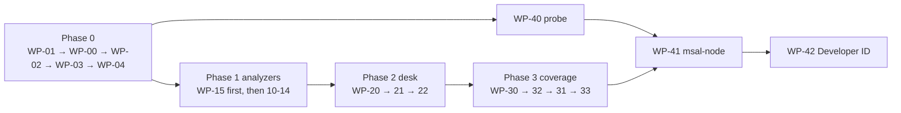

# Work package — Triage BETA 23 / desktop 0.23.0

Source: `review/2026-09-15/BETA-22-REVIEW.md` (agreed 15 Sep). Each item is written so it can be handed to a coding session on its own: scope, files, acceptance. Items inside a phase are independent unless a dependency is named. Estimates are working hours for one person with the codebase open.

Ground rules for every item: bump `BETA_BUILD` in `BETA/js/build.js` and the `?v=` cache-busters once per phase (not per item), add the changelog entry, keep `npm test` and `npm run test:browser` green, Mihai runs `git commit`/`git push` himself (CLAUDE.md), PowerShell syntax for commands.

---

## Phase 0 — land what exists (½ day)

### WP-00 Commit the Beta 22 tree in themed commits
Files: whole working tree (71 changed/untracked paths).
Do: after WP-01 deletions, commit in this order so history stays bisectable: (1) `desktop/` sources + `desktop/collector/*.ps1` + `desktop/scripts` + `runtime-lock.json`; (2) `BETA/` desk shell, analyzers, docs; (3) `tests/`, `tools/`, `package.json`, `package-lock.json`, `.github/workflows`; (4) root `README.md`, `SECURITY.md`, `CLAUDE.md`, Dockerfile changes. Decide separately whether `review/` belongs in the repo — if yes, `review/2026-09-15/admin-api-probe.html` and `serve-admin-api-probe.py` must not be served by Pages (move under `docs/internal/` or delete).
Accept: `git status` clean except `BETA/downloads/` (ignored); CI green on push (WP-02).

### WP-01 Delete dead code and the container beta
Files to remove (verified unreferenced by `BETA/index.html`, `tools/test.mjs`, `package.mjs`):
`BETA/js/{app,quick-shell,unified-workspace,workspace,embedded,report,worker,shared-findings,quick-auth,config}.js`, `BETA/css/{app,beta,quick,workspace}.css`, `BETA/beta.dom.test.mjs`, `BETA/quick.dom.test.mjs`, `BETA/docs/{AZURE-OPTION,BETA-7-GUIDE,PHASE-1-2-GUIDE}.md`.
Second commit (legacy container collector, exercised only by legacy tests): `backend/collector/`, `backend/policy.js`, `docker-compose.beta.yml`, `Initialize-BetaCollector.ps1`, `Configure-BetaExchangeRoles.ps1`, `tests/{collector.test,compose-smoke,docker-smoke}.cjs`, the three `backend/policy` tests in `tests/quick-safety.test.cjs` (lines 12-16), `tools/verify-beta6.py`, `tools/check-image-secrets.py`, and the `test:legacy:containers` script. Keep `backend/server.js` + `backend/exo.ps1` + `Dockerfile*` only if the **main** site's containment backend still uses them (it does — leave them).
Also: `BETA/index.html:77` footer "Build 21" → use `BETA_BUILD`; remove `BETA/tenant.html` redirect if nothing links to it (grep first).
Accept: `git grep -l "quick-shell\|unified-workspace\|backend/collector\|docker-compose.beta"` returns nothing; `npm test` and `npm run test:browser` green; packaged app size drops (WP-04 measures).
Est: 2 h.

### WP-02 CI that actually runs
Files: `.github/workflows/beta-tests.yml`.
Do: add `push: { branches: [main] }` to `on:`; add a `windows-latest` job that runs `npm ci`, `npm run desktop:runtime -- win32-x64`, `npm run desktop:package:win`, then extracts the ZIP and runs `Triage.exe --smoke-test` and asserts `{"loaded":true,"ready":true}`. Confirm the 20 "actual … PowerShell" tests resolve `-ModuleRoot` to `tests/fixtures` (not `desktop/runtime`) so they pass on runners that have `pwsh` but no bundled runtime; if they need the runtime, run `desktop:runtime` first in CI.
Accept: a push to `main` shows both jobs green in Actions.
Est: 2 h (Windows job may need one iteration).

### WP-03 Release pipeline (downloads off git)
Files: new `.github/workflows/release.yml` (delivered with this package), `BETA/js/desk.js` download links, `BETA/README.md`, `BETA/downloads/SHA256SUMS.txt` (delete from tree).
Do: tag `v0.22.0` on the committed tree → workflow builds on `macos-latest` and `windows-latest`, writes `SHA256SUMS.txt`, attaches all three files to the GitHub Release. Change the site's two download buttons to `https://github.com/nurejev/triage/releases/latest/download/Triage-macOS-arm64.zip` / `Triage-Windows-x64.zip` and show the SHA256SUMS link next to them. Until CI is proven, the manual equivalent is `gh release create v0.22.0 ./BETA/downloads/*.zip ./BETA/downloads/SHA256SUMS.txt`.
Accept: both links download from the Release; `BETA/downloads` no longer needed on the Pages branch.
Est: 1 h + one tag run.

### WP-04 Shrink the runtime
Files: `desktop/scripts/prepare-runtime.py`.
Do: after extraction delete `modules/ExchangeOnlineManagement/3.10.0/netFramework`, `modules/Microsoft.Graph.Authentication/2.37.0/custom` (verify `Connect-MgGraph`/`Invoke-MgGraphRequest` still import — they live in the .dll; `custom/` holds the generated cmdlet wrappers, test first), `Dependencies/runtimes/<other-os>`, `powershell/Modules/{PSReadLine,Microsoft.PowerShell.PSResourceGet}`, `*-Help.xml`, `en-US/` help folders. Keep the pruned list in `runtime-lock.json` so it is reproducible.
Accept: `preflight.ps1` reports ready; all `actual …` tests pass; both ZIPs ≥30 % smaller.
Est: 2 h.

---

## Phase 1 — analyzers stop crying wolf (1 day)

### WP-10 OAuth Low-scope flood
Files: `BETA/js/analyzers.js:418-430`, `BETA/js/blacklists.js:13-14`.
Do: `risky = scopes.filter(s => table[s] && SEV_RANK[table[s]] < SEV_RANK.Low)`; fix `Notes.Read.Al`, `Sites.FullControl.Al`, `Policy.Read.Identity.Protection`, `Policy.Read.Permission.Grant`; `COUNTRY.ID` → `Indonesia`. Use `grant.appId` for `blApp`, resolve `clientId` (SP object id) → appId through the `servicePrincipals` inventory when present, and say "app blacklist not evaluated (service principals not collected)" in the OAuth summary when absent.
Accept: quiet-tenant fixture (WP-15) yields no OAuth finding for `openid profile User.Read offline_access`.

### WP-11 ASN / country / app blacklists
Files: `BETA/js/blacklists.js`, `analyzers.js:236-252`, `review/2026-09-15/ANALYZER-PROVENANCE.json`.
Do: regenerate `BL.ASN` from `~/REPO/Microsoft-Analyzer-Suite/Blacklists/ASN-Blacklist.csv` at a recorded commit and record the hash in the provenance file; whatever the list says, severity for a blacklisted ASN becomes **Medium** and residential/tier-1 ISPs (AT&T, Comcast, BT, Telstra, NTT, Level 3, Arelion, Telecom Italia, Charter, Google) are dropped or moved to Info. Wire `ASN_WHITE`/`asnWhitelisted()` in. Remove OfficeHome, Office 365, Office 365 Exchange Online, Intune Company Portal, VS Code from `BL.APP`. Country hits → Medium, with a per-case "expected countries" input (NL default) that suppresses them.
Accept: quiet-tenant fixture has zero High from `blGroup`.

### WP-12 Interactive-only rules and session replay
Files: `analyzers.js:141, 186, 194-208`.
Do: honour the `interactive` flag: the 30-second different-IP rule and the OfficeHome "AiTM fingerprint" run only on `isInteractive === true`. Add rule **Session replay**: one `sessionId` with successful sign-ins from ≥2 distinct IPs (or ASNs) within the window → High, listing IPs/ASNs/UA. AiTM fingerprint requires OfficeHome+no device **and** (blacklisted/unknown ASN or session-replay hit) to be High; otherwise Info.
Accept: fixture with phone+laptop token refreshes 10 s apart → no finding; fixture with same `sessionId` from NL and NG IPs → High.

### WP-13 Dead and misfiring rules
Files: `analyzers.js:276-285, 327, 345-357, 404, 475`, `blacklists.js:18`, `collect.js:263-271`.
Do: iterate `BL.OPERATION` instead of `UAL_OPS` (case-insensitive `op` match); parse `OperationProperties` (`RuleName`, `RuleActions`, `RuleCondition`) for `UpdateInboxRules`; skip `confirmedSafe`/`riskLevel none` risky users; dormant-admin rule either collects `signInActivity` (`$select=…,signInActivity` on `/users`, needs `AuditLog.Read.All` — already held) in both collectors or is removed; add `Add member to role`, `Add eligible member to role`, `Add member to group` (role-assignable), `Update user` with `StrongAuthenticationMethod`, `Add unverified domain` to the directory-audit flag list. Stop hard-coding `permissionType:"Delegated"`.
Accept: fixture with Outlook-desktop `UpdateInboxRules` carrying `OperationProperties` forwarding action → High "forwarding rule".

### WP-14 Exchange snapshot analysis coverage
Files: `BETA/js/exchange-analysis.js`, `BETA/beta.engine.test.mjs:6`.
Do: load `exchange-analysis.js` in the engine test; add fixtures for forwarding rule, `ForwardingSmtpAddress`, non-owner FullAccess, audit bypass, `Default`/`Anonymous` folder permission not `None`.
Accept: each fixture produces exactly its expected finding.

### WP-15 Quiet-tenant negative fixture
Files: new `tests/fixtures/quiet-tenant.json`, `BETA/beta.engine.test.mjs`.
Do: real Graph-shaped records: beta sign-ins with `signInEventTypes`, OfficeHome browser sign-ins from KPN/Ziggo ASNs, non-interactive refreshes, `oauth2PermissionGrant` rows with only `principalId/consentType/scope`, `unifiedRoleAssignment` with `principalId + roleDefinition`, `userRegistrationDetails` with MFA registered, one `confirmedSafe` risky user, UAL `UserLoggedIn`/`MailItemsAccessed` from Outlook.
Accept: `assert.equal(findings.filter(f => f.sev !== "Info").length, 0)`.
Est phase 1: 8 h.

---

## Phase 2 — case integrity and desk fixes (1 day)

### WP-20 Harden `unpack` / attribute escaping
Files: `BETA/js/evidence.js:225-245`, `desk-model.js:200-204`, `desk.js:668, 801, 832`.
Do: `unpack` rejects `raw`/`manifest` keys outside CATALOG and non-array raw values; `coverage()` never lets manifest override `key`/`label`; `esc()` every attribute value built from evidence (`data-ref`, `data-source`, `id`, `aria-controls`); `badge()` tolerates undefined `outcome`. Add a tampered-bundle test (extra key, manifest `key` override, log entry without outcome) to `desk.dom.test.mjs`.
Accept: tampered bundle → import error, no blank page, no attribute injection.

### WP-21 Brand link and unload guard
Files: `BETA/index.html:19`, `desk.js`, `desktop/main.cjs:638-640`.
Do: brand becomes `<button data-page="home">`; `beforeunload` returns a prompt while `ev` exists or `busy`; main.cjs `will-navigate` denies everything (the page never legitimately navigates).
Accept: clicking the logo mid-collection keeps the case; `?localCase=1` viewer keeps working.

### WP-22 Desk behaviour fixes (one commit)
Files: `desk.js`, `desk.css`, `js/journal.js`, `desktop/main.cjs`.
Do: (a) readiness result rendered in a dialog regardless of open case; (b) save slot keyed by `caseId` + "Saved cases" list in Help/Home, confirm before overwrite; (c) "Analyzing…" panel while `analysisJob?.evidence === ev`; (d) non-primary `btn()` get `type="button"`; (e) single `collection-end`, tenant/live check before `collection-start` on resume; (f) hide "Customer connections" when `!N`; (g) style `.badge.confirmed/.investigating/.exception`; (h) focus `#main` after page change and the edited row after `review`/`record-outcome`/`add-note`; (i) show `#connection` ≤1050px as an icon+tooltip; (j) desktop: release Graph and Exchange workers together (`Promise.all`), private viewer token expires 15 min after first fetch.
Accept: `desk.dom.test.mjs` cases for a, b, d, e; manual for the rest with screenshots in `test-results/`.
Est phase 2: 8 h.

---

## Phase 3 — coverage and collector correctness (1 day)

### WP-30 Page caps and `$top`
Files: `collect.js:89-92, 163`, `graph.js:186`, `collect.ps1:44, 101-102`.
Do: per-source `maxPages` (signIns/audits/UAL 200, inventories 50); `$top=999` on roleAssignments, `$top=500` on userRegistrationDetails in both collectors; Overview shows a "partial set — analysis ran on N of ≥N records" banner whenever any source is `partial`.

### WP-31 UAL by target and directoryAudits split
Files: `graph.js:242`, `collect.ps1:111`, `collect.js:109-116`, `collect.ps1:94`.
Do: add `objectIdFilters:[objectId]` to the audit-query body in user scope; replace the `any() or initiatedBy` directoryAudits filter with two paged queries (`targetResources/any`, `initiatedBy/user/id`) merged by `id`, like OAuth. Verify once on a live tenant and record the result in `BETA/docs/VALIDATION.md`.

### WP-32 Web token/tenant pinning
Files: `graph.js:97`, `authConfig.js:8`, `collect.js:12-18`, `desk.js` plan form.
Do: popup fallback compares `result.account.homeAccountId`/`tenantId` with the captured account and throws on mismatch; web plan form gets the same "Target tenant ID" field as desktop and MSAL uses authority `/{tenantId}` when set; drop `Policy.Read.All` from both scope lists (and from `wizardSettings`/`New-TriageRegistrations.ps1` permission check — keep them in sync).

### WP-33 Cheap MAS coverage
Files: `collect.js`, `collect.ps1`, `analyzers.js`, `evidence.js` CATALOG, `core.cjs KEYS`.
Do: (1) third sign-in query `servicePrincipal`; (2) `appRoleAssignments` (user scope `/users/{id}/appRoleAssignments`, tenant per SP) → `BL.APP_PERM`; (3) PIM `roleEligibilityScheduleInstances` + `roleAssignmentScheduleInstances` (principalId filter in user scope) → eligible admins in the admins view; (4) MailItemsAccessed depth (`ClientInfoString`, `AppId`, `SessionId`, folder counts, UA/app blacklists); (5) UA/ASN checks on UAL `UserLoggedIn`; (6) weak-MFA rule from `methodsRegistered`/`defaultMfaMethod`; (7) Exchange snapshot adds `Get-TransportRule` and `Get-MessageTraceV2` (-10 days, sender/recipient = upn) — add both cmdlets to the fixed command list, the RBAC role generator and the profile permission preview. Each new source is a new CATALOG key with its own coverage row.
Accept: COVERAGE.md updated per MAS analyzer; engine tests per rule.
Est phase 3: 8–10 h.

---

## Phase 4 — sign-in architecture (2 days, the Mac fix)

### WP-40 Interim probe (do first, 1 h)
Files: `collect.ps1:76`, `main.cjs:69-135`.
Do: `Connect-MgGraph -ClientId <Triage app id> -TenantId $tenant …` (add "Mobile and desktop" platform `http://localhost` to the Triage registration first); tee worker stderr and `$Error` into `<attempt>/worker-<mode>.log`; reproduce on the Mac.
Accept: log shows the exact stage where it stalls; consent now lands on the Triage registration.

### WP-41 msal-node token hand-off
Files: `desktop/main.cjs`, new `desktop/auth.cjs`, `desktop/collector/collect.ps1`, `desktop/package.json` (`@azure/msal-node`), `tests/desktop*.mjs`, `BETA/docs/COLLECTOR.md`, `CUSTOMER-CONNECTIONS.md`.
Do: main process `PublicClientApplication` (Triage client id, authority `/{tenantId}`, loopback redirect, in-memory cache). Interactive for the Graph scope list; `acquireTokenSilent` for `https://outlook.office365.com/.default` (add delegated **Office 365 Exchange Online / Exchange.Manage** to the registration; verify the scope name in the portal before coding). Worker receives `{graphToken}` / `{exoToken, organization}` on stdin exactly like the certificate credential; `collect.ps1` uses `Connect-MgGraph -AccessToken (ConvertTo-SecureString …)` and `Connect-ExchangeOnline -AccessToken $t -Organization $org -ShowBanner:$false`; keep all post-connect identity checks. On 401 the worker emits `TRIAGE_PROGRESS:{type:"token-expired",mode}` and blocks on stdin for a fresh token from main. `redact()` gets the tokens added to its secret list. Remove `-DisableWAM`, the UPN-hint text, the "same account twice" guidance; keep the 10-minute watchdog. Certificate mode unchanged.
Accept: one browser prompt per case on macOS and Windows; Exchange connects without a second prompt; `desktop-connections` tests updated to feed tokens via stdin; live Mac acceptance recorded in VALIDATION.md.
Est: 12–16 h.

### WP-42 Developer ID + notarization (when the certificate exists)
Files: `desktop/scripts/package.mjs`, `release.yml`, `BETA/README.md` (drop the `xattr` section).
Do: `osxSign` with the Developer ID identity, `osxNotarize` with Apple ID/app-specific password or API key from repository secrets; `hardenedRuntime: true` with the JIT entitlement; staple. Windows: leave unsigned for now, document SmartScreen.
Accept: fresh download opens on a clean Mac with no `xattr`; Keychain prompts for safeStorage once, not per build.

---

## Order and dependencies



WP-40 can run tonight in parallel with Phase 0 because it only touches one line and adds logging. Everything in phases 1–3 ships as BETA 23; WP-41/42 as BETA 24 / desktop 0.24.0.

Commands for Phase 0 (PowerShell):

```powershell
Set-Location ~/REPO/triage
Remove-Item -Force BETA/js/app.js, BETA/js/quick-shell.js, BETA/js/unified-workspace.js, BETA/js/workspace.js, BETA/js/embedded.js, BETA/js/report.js, BETA/js/worker.js, BETA/js/shared-findings.js, BETA/js/quick-auth.js, BETA/js/config.js
Remove-Item -Force BETA/css/app.css, BETA/css/beta.css, BETA/css/quick.css, BETA/css/workspace.css, BETA/beta.dom.test.mjs, BETA/quick.dom.test.mjs, BETA/docs/AZURE-OPTION.md, BETA/docs/BETA-7-GUIDE.md, BETA/docs/PHASE-1-2-GUIDE.md
npm test; npm run test:browser
git add -A desktop; git commit -m "desktop 0.22.0: portable Electron collector with bundled PowerShell runtime"
git add -A BETA; git commit -m "BETA 22: desk workspace, customer certificate profiles, remove unused beta shells"
git add -A tests tools package.json package-lock.json .github; git commit -m "tests: Node/PowerShell validation suite, CI on push, release workflow"
git add -A README.md SECURITY.md CLAUDE.md Dockerfile .dockerignore .gitignore docker; git commit -m "docs: beta 22 status and release/download hosting"
git push
git tag v0.22.0; git push origin v0.22.0
```
