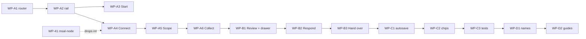

# Work package — Triage workflow: one flow, seven steps (BETA 31 / desktop 0.31.0)

Source: `WORKFLOW-ADVICE.md` (this folder), the published page *Triage Flow Redesign* (`workflow-redesign.html`, flow diagrams) and the layout reference *Triage Beta Flow* (`triage-beta-prototype.html`, the seven steps inside the BETA 30 shell on the real `desk.css`). Written against the BETA 30 working tree of 16 Sep. Each item can be handed to a coding session on its own: scope, files, what to do, acceptance. "Rule n" refers to the navigation contract in the advice, section 4. Estimates are working hours for one person with the codebase open.

Ground rules, as before: bump `BETA_BUILD` in `BETA/js/build.js` and the `?v=` cache-busters once per phase, add the changelog entry, keep `npm test` and `npm run test:browser` green, Mihai runs `git commit`/`git push` himself (CLAUDE.md), PowerShell syntax for commands. Phases A and B ship together as BETA 31 / desktop 0.31.0; C and D as BETA 32. WP-40/41 from the BETA 23 package are unchanged and independent; WP-A4 is designed so that WP-41 drops into it without changing the screen.

---

## Phase A — the frame (≈ 20 h)

### WP-A1 Hash router and history (rule 3)
Files: `BETA/js/desk.js` (state at `:37-56`, `render()` `:263-308`, click handler `:1566-1598`, `beforeunload` `:1561-1565`), `desktop/main.cjs:78-85` (`trusted()`), `BETA/desk.dom.test.mjs`.
Do: replace the `page` / `source` / `offset` / `phase` globals with one `route` object parsed from `location.hash` (`step`, `caseId`, `tab`, `phase`, `f`, `r`, `s`, `page`). `navigate(route, {replace})` writes it with `history.pushState`/`replaceState` and renders; `popstate` re-parses and renders. `data-page` buttons become `data-route`. Routes:

```
#/start
#/connect
#/scope
#/collect
#/case/<caseId>/review/overview
#/case/<caseId>/review/findings?f=<findingId>
#/case/<caseId>/review/timeline?r=<source:n>
#/case/<caseId>/review/evidence?s=<source>&r=<source:n>
#/case/<caseId>/respond/<preserve|contain|scope|evidence|handover>
#/case/<caseId>/handover
```

Keep `?localCase=1` and `?scope=` as query parameters (they are read once at load). A route whose case is not loaded redirects to `#/start` with a message (until WP-C1 restores it). `trusted()` compares `new URL(event.senderFrame.url)` origin + pathname against `origin + "/BETA/index.html"` so a hash does not break IPC; `will-navigate` stays denied (hash changes do not fire it).
Accept: Back from a drawer closes it; Back from Review goes to the previous route, never off the site; the private viewer (`/view/<token>/BETA/index.html?localCase=1`) still opens the case; every desktop IPC call succeeds with a hash in the URL (`tests/desktop-smoke.mjs` loads `#/start`).
Est: 5 h.

### WP-A2 The sidebar becomes the step rail (rules 1, 8, 9)
Files: `BETA/index.html:17-86` (shell — stays), `desk.js` `nav` `:83-93` and `renderChrome()` `:225-262`, `BETA/css/desk.css` (about 15 new lines; nothing removed).
Do: keep `.shell`, `.sidebar`, `.topbar`, `.casebar`, `#execution-status` and the mobile treatment as they are. The `nav` array becomes the seven steps; each button renders `<span class="nav-icon step" data-state="done|now|todo">n</span>` (✓ when done) and `<span class="nav-text">Name<small>status</small></span>`; state and status come from case state (`done` / `now` / `todo` with `aria-disabled` + `title` reason: "Sign in first", "Choose the scope first", "After collection", "After Respond"). Review expands into four `button.sub` items (Overview · Findings · Timeline · Evidence). Keep the `nav-collection` pill + Stop while collecting, the `<hr>` and *Help · coverage*, and the side-bottom block. Going back to Scope/Connect with a case open asks for confirmation ("This starts a new collection"). Topbar: breadcrumb reads *Limon-IT / Step n of 7 / Name*; `#signin` becomes *Sign in* (navigates to Connect, never opens a popup) or *Disconnect*. Case bar adds the save state next to the record count. CSS (from the prototype): `.nav-icon.step[data-state]`, `.nav-text small`, `nav button.sub`, `nav button[aria-disabled]`.
Accept: rail on every route; with no case only Start and Connect are enabled; `desk.dom.test.mjs` asserts the disabled states, the sub-items, and the ≤ 760 px strip.
Est: 3 h.

### WP-A3 Start
Files: `desk.js` `home()` `:309-318`, `handle("load"/"load-case"/"import"/"demo"/"new")` `:1233-1329`, `newCasePanel()` `:461-463`.
Do: three actions — **New investigation** (→ `#/connect`, or `#/scope` when already connected), **Open a case** (file input + the saved-cases list, always the list: drop the `saved.length > 1` branch at `:1289`), **Try the sample**. App: **Continue last case** (newest of `N.listCases()`) and **Open a plan** (file picker; also drag-and-drop of a `.json` plan onto the window → existing `N.onPlan`). One tertiary line *Get the desktop app* (web) linking to the release assets. With a case open, `#/start` redirects to `review/overview`; the case chip's *New investigation* opens today's save-first panel as a confirmation dialog whose confirming action calls `resetCase()` and navigates (a confirmation may navigate; a link inside a dialog may not — rule 4).
Accept: no hero copy; every button on Start leads to exactly one route; the saved-cases list shows one saved case too.
Est: 2 h.

### WP-A4 Connect (rule 6)
Files: `desk.js` (new `connectView()`, `handle("signin")` `:1220-1232`, `webCollect()` `:1079`, `customerAction()` `:361-450`, `checkReadiness()` `:950-971`), `BETA/js/graph.js` (`signIn` gets the authority per tenant), `BETA/js/authConfig.js:8`, `desktop/main.cjs` (`collect()`/`acquire()` `:185-549` split), `desktop/preload.cjs`, `desktop/collector/collect.ps1` (`:117-129`), `tests/desktop-connections.mjs`, `BETA/docs/COLLECTOR.md`, `CUSTOMER-CONNECTIONS.md`.
Do, web: one card *Sign in with Microsoft* above a *Tenant* field with two choices — *My organisation* (authority `/organizations`, today's behaviour) or *Customer tenant: domain* (resolve `contoso.com` → tenant ID + display name through `https://login.microsoftonline.com/<domain>/.well-known/openid-configuration`, unauthenticated; then authority `/<tenantId>` — this also closes WP-32's pinning). After the popup the card shows account, tenant, "read-only permissions granted", *Disconnect*. `webCollect()` throws "Sign in on Connect first" instead of calling `G.signIn()`. The web CSP `connect-src` (`docker/nginx.conf:34`) and the desktop CSP (`main.cjs:622`) already allow `login.microsoftonline.com`, so the lookup needs no CSP change.
Do, app: readiness runs when the route opens (`N.preflight()` once per app run, inline progress, retry link on failure — the dialog and the two buttons go). *Sign in as*: delegated (default) or a customer certificate profile (`customerProfiles`); *Manage…* opens today's profile dialogs, which stay dialogs (they collect forms). Tenant: derived from the profile, or the same *My organisation / Customer tenant* choice as the web (`Connect-MgGraph -TenantId` needs it before sign-in for partner accounts — this is why the GUID field exists today; the domain resolves it). Two rows: **Microsoft Graph · required** and **Exchange Online · optional**, each with *Sign in* → `N.connect({service, tenantId, connection})`; states waiting / connecting (elapsed seconds, *Cancel* kills that child only) / ready (account) / failed (error inline, *Try again*). Main: `triage:connect` starts `collect.ps1 -Mode <service> -WaitForCollection` from a *connection plan* (`tenantId`, `connection`, `services`) and keeps the session in a `pending` map; `triage:collect` writes the full `plan.json` into the attempt folder and sends the `collect` release line; sessions idle > 30 min are closed and the UI returns to Connect with "Your Graph session ended — sign in again". `collect.ps1`: move the subject lookup (`:117-123`) after `Await-Collection` and re-read `$PlanPath` there; scopes at connect = the base list plus every `$extra` entry except `Mail.Read.Shared` (`:109-111`); when the plan later includes `messages`/`attachments`, the Collect screen shows one extra *Sign in for mailbox content* row before starting (worker reconnects with the added scope). Certificate mode: rows show *Authenticating with certificate…* and never open a browser.
Respond: until WP-41, `response.ps1` stays, but *Connect account checks* and *Arm* are presented as the same rows (see WP-B2). After WP-41 the Graph row inherits Exchange and Respond silently.
Accept: app — pressing *Sign in* opens exactly one browser window, the row counts seconds, Cancel stops it, success shows account + tenant, *Next* is enabled only when Graph is ready; web — no action outside Connect calls `G.signIn()` (`git grep "G.signIn"` shows one call site); `tests/desktop-connections.mjs` covers connect → idle timeout and connect → cancel → retry with the synthetic worker; a customer domain resolves to the same tenant ID the profile would carry.
Est: 8 h (web 2, app 6).

### WP-A5 Scope
Files: `desk.js` `form()` `:455-460`, `readForm()` `:319-335`, `makePlan()` `:1163-1178`, `planValues` `:65-82`, `desk-model.js plan()` `:306-346`, `js/app.js` (port `upnInput`/`upnSugg`), `collect.ps1` (a `lookup` command while waiting), `desk.css`.
Do: *Investigation scope* toggle; *Affected account* with suggestions — web: `G.gfetch('/v1.0/users?$filter=startswith(userPrincipalName,…)&$top=8')` on input, debounced; app: a *Check account* action that sends `lookup <upn>` to the waiting Graph worker (`collect.ps1` answers `TRIAGE_LOOKUP:{id,displayName,userPrincipalName}` before the release line) and shows the display name — a wrong UPN is caught before collection. *Lookback* select. *Evidence preset* cards: **Quick** = today's web default set (`:73-81`), **Standard** = Quick + `ual`, `admins`, `mfa`, `devices`, `servicePrincipals`, `exchange` (app; disabled in tenant scope because `exchange` needs one account, `desk-model.js:331`), **Everything** = full catalog with the duration and mail-content warning, **Custom** = today's checklist, collapsed. App: *Where evidence is stored* collapsed (`storageControls()`). Web: Standard/Everything replaced by the *Continue in the desktop app* card (download link, *Open a plan* instruction, **Save plan** = today's `export-plan`); delete the Portable collector page (`collector()` `:513-528`) and the plan dialog (`handle("plan")` `:1425`). Primary button **Start collection →** = today's `web-start` / `native-start`. Tenant ID comes from Connect; the field is removed from the form.
Accept: a mistyped account is refused with the Graph error before any source is read; presets select exactly the documented sets (`desk.dom.test.mjs`); tenant scope disables Standard with the reason; the web shows the hand-off card and never the desktop form.
Est: 4 h.

### WP-A6 Collect
Files: `desk.js` `overview()` `:785-812` (split), `coverageSummary`/`sourceRows` `:677-715`, `connectionRows()` `:147-172`, `collectionDetails()` `:539-558`, `refreshCollection()` `:559-580`, `webCollect()` `:1065-1162`, `native-start` `:1438-1514`.
Do: `collectView()` = connection chips, progress meter, *Collecting now · …*, the full source list (all selected sources, not "7 of 34"), **Stop**, collapsed *Collection details*. Nothing else. While `busy`, Review/Respond are disabled in the rail ("After collection"). When collection ends: the same screen shows *Analyzing…* until `analyze()` resolves, then `navigate(review/overview)` with a toast *Collection finished · n / m sources complete, k partial*. Partial or failed sources set `ev.needsResume`; Review shows a banner with **Resume** (web, existing `webCollect(true)`) or **Collect again** (app, re-runs the plan for the incomplete sources). Remove the Evidence header's *Resume incomplete web sources* (`:865-867`).
Accept: during collection the URL is `#/collect` and the rail shows step 4; Stop keeps records and still advances to Review; the toast text matches `collectionCoverage()`.
Est: 3 h.

---

## Phase B — Review and Respond (≈ 12 h)

### WP-B1 Review tabs and the finding drawer (rules 4, 5)
Files: `desk.js` (`findingsView` `:824-834`, `timelineView` `:838-859`, `evidenceView` `:860-871`, finding click `:1585-1592`, `handle("record")` `:1357-1365`, `handle("finding-source")` `:1550`, `handle("source")` `:1345-1356`, `findingContext()` `:880-883`), `desk.css`, `desk.dom.test.mjs`.
Do: `reviewView()` with the four sub-pages selected from the sidebar (`route.tab`); Overview = today's overview (tiles, signals, coverage, latest activity) with *Respond →* as its action. The finding detail is an `<aside class="panel drawer">` docked right in a `.drawer-layout` grid (`minmax(0,1fr) minmax(320px,420px)`), using the existing `.dialog-head` for its header — non-modal, Esc and Back close it, focus moves in and returns to the opener — rendered when `route.f` or `route.r` is set; ≤ 900 px it stacks under the list. Finding drawer: badges, detail, the review form unchanged (`validateReview`, drafts), **Supporting evidence** = `sourceDetails(findingSource(f))` inside the drawer, records open as a second level with *← Back to finding* (`route.r`); buttons *Save review* and *Contain this account →* (→ `respond/contain` with the finding's user preselected). Timeline and Action-log `data-ref` buttons open the record drawer. `dialog()` remains only for confirmations, readiness, phase notes and the profile forms.
Accept: clicking a finding never changes the tab; Back closes the drawer and keeps the scroll position; `#/case/<id>/review/findings?f=<id>` opens the drawer on load; `desk.dom.test.mjs` covers open → Back → closed.
Est: 5 h.

### WP-B2 Respond embedded, one session, one handover
Files: `BETA/js/first-hour.js`, `js/contain.js` (`render()` `:735-748`, `onAct` `:882-889`, `start()` `:1520`), `desk.js` (`render()` `:278-307`, `openResponse`/`mountResponse` `:884-898`, `TriageApp` shim `:901`, `runbook()` `:904-906`, `mailboxCard()` `:910-919`), `desktop/main.cjs` (`triage:response-connect` `:718-722`), `desk.css`.
Do: `TriageContain.start(user, {embedded: true, …})` skips the `#containHead` header (no *← Other account*, *Back to the report*, *Action log CSV*, *Handover report*) and the "What triage found" card's *Back to the report* button; delete the `window.TriageApp` shim. `#screen-contain` lives permanently inside `#hour-response-slot`; remove the `after()`/`append()` juggling. Phase 1: the three checks are derived (account, tenant, coverage) with *Export starting point* as one click. Phase 2, in order: *Affected account* chip (tenant scope: inline picker, replaces the `Choose the affected account` dialog `:891`), **Response session** row (until WP-41: `N.responseConnect` presented like a Connect row with waiting state; web: silent when the tenant matches, otherwise "Sign in on Connect with an account in this tenant"), **Arm containment** row with the sentence *This opens a Microsoft permissions window once per tenant. Actions still confirm one by one.*, then the contain.js cards. Remove *Export handover ↗* from the page head (`first-hour.js:29`) — the export lives on Hand over. Next-phase buttons unchanged; the last phase's *Next* becomes **Hand over →**.
Accept: `git grep "TriageApp\."` returns nothing in `BETA/`; no `#containHead` markup in the BETA DOM; exactly one handover export in the whole app; in the app, *Connect account checks* shows elapsed seconds while waiting.
Est: 5 h.

### WP-B3 Hand over
Files: `desk.js` (new `handoverView()`, `handle("handover"/"export-log"/"export")` `:1266, 1412-1421`, `resetCase()` `:464-488`), `desk-model.js` (`handover()` `:257-305` unchanged).
Do: checklist rows derived from `findings`/`ev.dispositions` (reviewed / unreviewed, link `review/findings?state=unreviewed`), `M.latest` per phase, `E.coverage` gaps; three exports **Case file**, **Handover**, **Action log** with "saved to …" (app) or "downloaded" states; **Start next investigation →** = `resetCase()` + `#/start` (the case is autosaved by WP-C1; until then it calls `saveCurrentCase()` first).
Accept: the three files are byte-identical to today's exports for the same case; the unreviewed link applies the filter.
Est: 2 h.

---

## Phase C — never lose work (≈ 8 h)

### WP-C1 Autosave and restore (rule 7)
Files: `desk.js` (`log()` `:113-115`, `M.review`/`M.outcome` call sites, `saveCurrentCase()` `:489-497`, `openCase()` `:1031-1049`, boot `:1734-1756`), `js/journal.js`, `desktop/main.cjs` (`triage:save-case` `:891-905`).
Do: `markDirty()` after every case mutation → debounced (2 s) `saveCurrentCase()`; web storage needs the person's one-time consent (*Keep cases on this device* on Scope, remembered in `localStorage`, default on in the app); on boot, a `#/case/<id>/…` route loads the case from `TriageJournal.open(id)` / `N.loadCase(id)`; `beforeunload` warns only when dirty (and during collection, as today). Case chip shows *Saved 12:04* / *Unsaved changes* / *Saving…*.
Accept: reload at any case route restores it; a review typed, then Back, then Forward keeps its draft; with consent off on the web the chip says *Not stored on this device* and export is offered on Hand over.
Est: 4 h.

### WP-C2 Header chips (rule 9)
Files: `desk.js renderChrome()`, `index.html`, `desk.css`.
Do: case chip (subject · tenant · records · save state) and session chip (account · tenant · Graph/Exchange state from `serviceConnections` or `G.account` · *Write: armed/not armed* from `TriageContain.armed`); ≤ 760 px collapse to icons with a tap-to-expand sheet.
Accept: chips update during Connect, Collect and Arm without a full re-render flicker (diff the markup as `executionStatus()` does today).
Est: 2 h.

### WP-C3 Tests for the frame
Files: `BETA/desk.dom.test.mjs`, `tests/desktop-connections.mjs`, `tests/desktop-progress.mjs`.
Do: route tests (rail disabled states; drawer open/Back; reload restore with a stored case; Start collection refused when not connected); desktop connect/collect split with the synthetic worker (connect → collect → end; connect → idle timeout; connect → cancel); smoke test loads `#/start`.
Accept: `npm run test:browser` and the three `node tests/desktop-*.mjs` runs green on the Mac VM (Node-only) and in CI.
Est: 2 h.

---

## Phase D — words (≈ 4 h)

### WP-D1 Naming sweep
Files: `desk.js`, `first-hour.js`, `js/contain.js` (BETA-embedded strings only), `coverage.js`, `build.js`.
Do: apply the table in the advice, section 5 — one name per thing; changelog entry *BETA 31 — one flow, seven steps*; footer *Build 31 · Help*.
Accept: `git grep -i "quick web\|portable collector\|run full triage\|check desktop readiness\|connect account checks" BETA/js` returns nothing.
Est: 1 h.

### WP-D2 Guides
Files: `BETA/docs/USER-GUIDE.md` (rewrite), `BETA/docs/QUICK-USER-GUIDE.md` and `WALKTHROUGH.md` (retire to `BETA/docs/legacy/` or delete — both describe removed builds), `BETA/README.md` sections *Run a quick check*, *Start another investigation*, `desk.js` `handle("help")` `:1552-1556`.
Do: the user guide follows the seven steps with a web column and an app column per step, and one screenshot per step from `test-results/`; in-app Help = the seven steps in one paragraph each + the coverage page (`coverage.js` stays) + links to the guide and validation record.
Accept: every screen name in the guide exists in the app; no reference to `tenant.html`, Docker, *Response plan* or *Investigate*.
Est: 3 h.

---

## Order and dependencies



WP-A1 and WP-A2 are the only items that touch everything; do them in one sitting and land them before the rest. WP-A4's app part is the largest single item; its web part (2 h) can go first so the web flow is complete before the desktop split. Ship A + B as BETA 31 / desktop 0.31.0, C + D as BETA 32.

Commands (PowerShell, from `~/REPO/triage`):

```powershell
Set-Location ~/REPO/triage
python3 bump.py "BETA 31: one flow, seven steps" "new|Start, Connect, Scope, Collect, Review, Respond, Hand over replace the sidebar; Back and reload work; sign-in only on Connect"
npm test
npx playwright install chromium
npm run test:browser
node tests/desktop-smoke.mjs; node tests/desktop-connections.mjs; node tests/desktop-progress.mjs
npm run desktop:runtime
npm run desktop:start          # walk ①→⑦ once on the test tenant; note every browser window that opens
git add -A BETA desktop js/journal.js tests; git commit -m "BETA 31: one guided flow — step rail, hash router, Connect/Scope/Collect screens, finding drawer, embedded runbook"
git push
```
